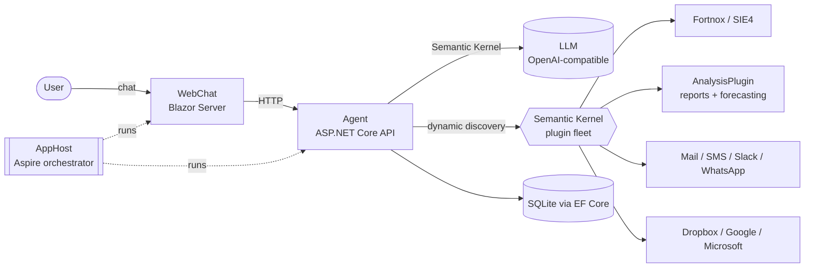

<div align="center">

# Isa — AI Accounting Agent

**A chat-driven AI assistant for Swedish accounting and finance, built on .NET Aspire and Microsoft Semantic Kernel.**

You talk to it in Swedish (or English). It orchestrates a fleet of plugins to pull bookkeeping data, run financial analysis, forecast trends, and hand you a finished Excel or PDF report.

[](https://dotnet.microsoft.com/)
[](https://learn.microsoft.com/dotnet/aspire/)
[](https://github.com/microsoft/semantic-kernel)
[](https://learn.microsoft.com/aspnet/core/blazor/)
[](LICENSE)

</div>

> [!NOTE]
> This is a **sanitized public snapshot** of a private project, shared as a portfolio / reference example of what you can build with Semantic Kernel and .NET Aspire. All credentials, API keys, customer data, and internal infrastructure details have been removed or replaced with placeholders. It is published for **reading and learning** — it will not run end-to-end without your own API keys and configuration.

---

## What it does

Isa turns a free-form request like

> *"Make me a professional quarterly report showing revenue, COGS, and gross profit for the last five years and email it to me."*

into a finished, formatted report. Under the hood the agent:

1. **Understands the request** — `NaturalLanguageService` extracts report parameters from free-form Swedish.
2. **Fetches the data** — pulls **SIE4** bookkeeping exports via the Fortnox integration.
3. **Classifies it** — maps accounts against the Swedish **BAS** chart of accounts.
4. **Computes the numbers** — revenue, cost of goods sold, gross profit, and other KPIs.
5. **Forecasts** — time-series projection with MathNet.Numerics.
6. **Composes the report** — assembles charts, pivots, tables, and a KPI front page into a styled **Excel/PDF** document (ClosedXML / EPPlus).
7. **Delivers it** — archives the file and emails it out.

The agent is the only orchestrator. Plugins never call each other directly — they expose `[KernelFunction]`s (with Swedish descriptions) and the LLM decides what to call, and in what order.

## Architecture

Three deployable services, orchestrated by .NET Aspire:



- **`src/AppHost`** — the Aspire distributed-application host that wires up and runs the other services plus the dashboard.
- **`src/Agent`** — the brain. An ASP.NET Core Web API hosting a Semantic Kernel `Kernel` wired to an OpenAI-compatible chat-completion endpoint. It **discovers and loads plugins dynamically at runtime** (`[PluginDiscoverable]`, `DynamicPluginDiscoveryService`), runs chat, scheduled workflows (Quartz), and document interpretation. Persists to SQLite via EF Core.
- **`src/WebChat`** — a Blazor Server UI (interactive server components, Syncfusion) where the user logs in and chats. Pages for chat, workflows, history, plugin management, and settings.

## The plugin fleet

The plugins are the agent's hands. The flagship is **AnalysisPlugin**; the rest connect Isa to the outside world.

| Plugin | Role |
|---|---|
| **AnalysisPlugin** (flagship) | SIE4 parsing, BAS classification, metrics, ML forecasting, Excel/PDF report composition |
| **FortnoxPlugin** | Fortnox accounting integration (SIE4 export, OAuth) |
| **DocumentInterpreterPlugin** | OCR + interpretation of invoices/receipts (Tesseract) |
| **CompanyCheckupPlugin** | Company lookups (Bolagsverket, SCB, OpenCorporates) |
| **MailPlugin** / **SmsPlugin** / **WhatsAppPlugin** / **SlackPlugin** | Outbound communication channels |
| **DropboxPlugin** / **GoogleWorkspacePlugin** / **MicrosoftOfficePlugin** | File & document access |
| **GoogleSearchPlugin** | Web search |
| **OpenCagePlugin** / **OpenMeteoPlugin** | Geocoding & weather |
| **DateTimePlugin** | Date/time reasoning |

## Tech stack

- **.NET 9**, strict build (`TreatWarningsAsErrors`, `Nullable=enable`)
- **.NET Aspire 9** for orchestration
- **Microsoft Semantic Kernel 1.58** + OpenAI SDK (routed through an OpenAI-compatible endpoint)
- **Blazor Server** with Syncfusion components
- **SQLite** + **EF Core 9**
- **Quartz** for workflow scheduling
- **ClosedXML / EPPlus** for Excel/PDF, **MathNet.Numerics** for forecasting
- **xUnit** + Playwright for testing across unit, integration, and E2E layers

## Repository layout

```
src/
  AppHost/                  Aspire orchestrator
  Agent/                    Web API — the agent runtime
  WebChat/                  Blazor Server UI
  AnalysisPlugin/           Flagship: analysis & reporting
  *Plugin/                  ~17 Semantic Kernel plugins
  ServiceDefaults/ Shared/  Cross-cutting helpers
tests/                      xUnit unit/integration + Playwright E2E
docs/                       Architecture Decision Records (50+) and guides
config/                     Deployment & app config templates
```

## Getting started

> Reading the code? Start with `src/Agent/Program.cs` (plugin discovery + kernel setup) and `src/AnalysisPlugin` (the flagship feature).

Running it locally requires your own credentials. In broad strokes:

1. **Prerequisites** — [.NET 9 SDK](https://dotnet.microsoft.com/download), and an OpenAI-compatible chat endpoint.
2. **Configuration** — copy the placeholder values in `src/Agent/appsettings.json` and `src/WebChat/appsettings.json` and fill in your own keys (LLM endpoint, and whichever integrations you want to exercise). Nothing real ships in this repo.
3. **OCR models** — the OCR plugin needs Tesseract language data (`eng.traineddata`, `swe.traineddata`) placed in `src/DocumentInterpreterPlugin/tessdata/`. These are not committed (35 MB of binaries); download them from [tessdata](https://github.com/tesseract-ocr/tessdata).
4. **Run** — `dotnet run --project src/AppHost` starts the agent, the web UI, and the Aspire dashboard.
5. **Test** — `dotnet test` runs the suite.

## A note on the sample data

The bookkeeping samples under `tests/**/TestData/` and `src/Agent/sample-financial-data.sie` are **synthetic** (fictional companies, made-up figures) used purely to exercise the SIE4 parser and the report engine.

## License

[MIT](LICENSE) — do what you like, no warranty.

---

<div align="center">
<sub>Topics: <code>dotnet</code> · <code>csharp</code> · <code>dotnet-aspire</code> · <code>semantic-kernel</code> · <code>ai-agent</code> · <code>llm</code> · <code>blazor</code> · <code>accounting</code> · <code>fintech</code> · <code>sie4</code> · <code>bookkeeping</code> · <code>openai</code></sub>
</div>
