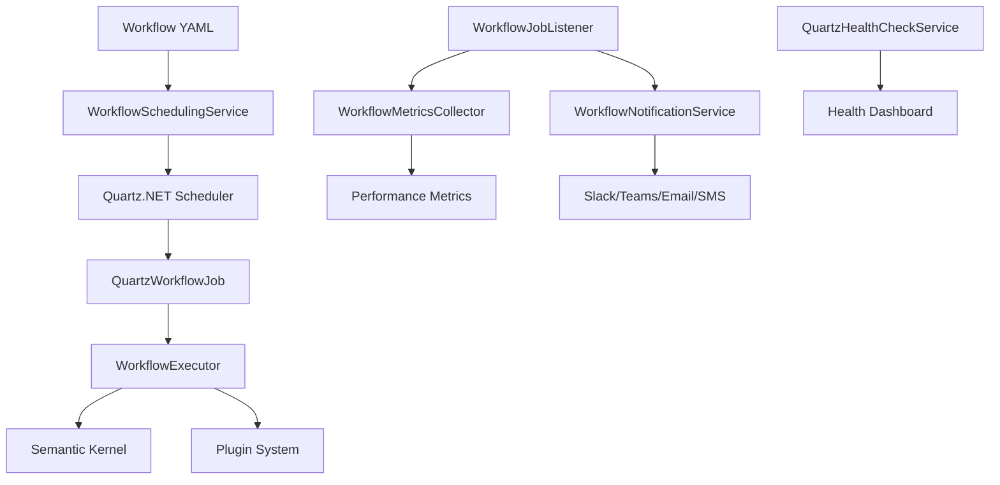

# Quartz.NET Workflow System - Complete Guide

## 📋 Overview

This guide covers the complete Quartz.NET workflow system implementation that replaces the previous TickerQ-based scheduling system. The new system provides robust workflow scheduling, execution, monitoring, and notification capabilities.

## 🏗️ Architecture

### Core Components

1. **WorkflowSchedulingService** - Manages workflow scheduling with Quartz.NET
2. **WorkflowExecutor** - Executes individual workflows and steps
3. **QuartzWorkflowJob** - Quartz job wrapper for workflow execution
4. **WorkflowMetricsCollector** - Collects and tracks workflow performance metrics
5. **WorkflowNotificationService** - Handles multi-channel notifications
6. **QuartzHealthCheckService** - Provides comprehensive health monitoring

### System Flow



## 🚀 Getting Started

### 1. Configuration

Update `appsettings.json` with Quartz and notification settings:

```json
{
  "Quartz": {
    "quartz.scheduler.instanceName": "WorkflowScheduler",
    "quartz.scheduler.instanceId": "AUTO",
    "quartz.threadPool.type": "Quartz.Simpl.SimpleThreadPool, Quartz",
    "quartz.threadPool.threadCount": "10",
    "quartz.jobStore.type": "Quartz.Simpl.RAMJobStore, Quartz"
  },
  "WorkflowNotifications": {
    "EnableFailureNotifications": true,
    "EnableConsecutiveFailureAlerts": true,
    "EnableRecoveryNotifications": true,
    "EnableDailySummary": true,
    "SlackWebhookUrl": "https://hooks.slack.com/your-webhook",
    "TeamsWebhookUrl": "https://your-teams-webhook",
    "EmailRecipients": "admin@company.com",
    "SmsRecipients": "+1234567890",
    "ConsecutiveFailureThreshold": 3,
    "CriticalFailureThreshold": 5,
    "EnableRateLimiting": true,
    "RateLimitMinutes": 15,
    "QuietHours": ["22:00-06:00"]
  }
}
```

### 2. Service Registration

Services are automatically registered in `Program.cs`:

```csharp
// Quartz.NET configuration
builder.Services.AddQuartz(q =>
{
    q.UseMicrosoftDependencyInjection();
    q.UseInMemoryStore(); // or UsePersistentStore for production
    q.UseDefaultThreadPool(tp => tp.MaxConcurrency = 10);
});

// Workflow services
builder.Services.AddSingleton<WorkflowSchedulingService>();
builder.Services.AddSingleton<WorkflowMetricsCollector>();
builder.Services.AddSingleton<WorkflowNotificationService>();
builder.Services.AddSingleton<WorkflowJobListener>();

// Health checks
builder.Services.AddHealthChecks()
    .AddCheck<QuartzHealthCheckService>("quartz-scheduler");
```

## 📝 Workflow YAML Format

### Basic Structure

```yaml
id: "example-workflow"
name: "Example Workflow"
description: "Demonstrates workflow capabilities"
schedule: "0 0 9 * * ?" # Daily at 9 AM (Cron) or "PT30M" (ISO 8601 duration)
misfireHandling: "run_immediately" # or "skip", "reschedule"
onSuccess: "success-notification-step"
onError: "error-handling-step"

jobs:
  - name: "main-job"
    steps:
      - id: "step1"
        prompt: "Process daily reports"
        actionType: "AI"
        onSuccess: "step2"
        onError: "error-step"
        
      - id: "step2"
        prompt: "Send summary to Slack"
        actionType: "SlackPlugin"
        parameters:
          channel: "#reports"
          message: "Daily report processed successfully"
          
      - id: "error-step"
        prompt: "Handle error and notify team"
        actionType: "MailPlugin"
        parameters:
          to: "admin@company.com"
          subject: "Workflow Error"
          body: "An error occurred in the daily report workflow"
```

### Advanced Features

#### Variable Substitution
```yaml
steps:
  - id: "personalized-step"
    prompt: "Hello {{userName}}, today is {{currentDate}}"
    actionType: "AI"
```

#### Conditional Execution
```yaml
steps:
  - id: "conditional-step"
    prompt: "Check if it's weekend"
    actionType: "AI"
    onSuccess: "weekend-step"
    onError: "weekday-step"
```

#### Plugin Integration
```yaml
steps:
  - id: "slack-notification"
    prompt: "Send notification"
    actionType: "SlackPlugin"
    parameters:
      channel: "#general"
      message: "Workflow completed"
      
  - id: "email-report"
    prompt: "Send email report"
    actionType: "MailPlugin"
    parameters:
      to: "team@company.com"
      subject: "Weekly Report"
      body: "Please find the weekly report attached"
```

## 🔧 API Endpoints

### Workflow Management

#### Schedule Workflow
```http
POST /api/workflows/schedule
Content-Type: application/json

{
  "workflowYaml": "id: test-workflow\nname: Test..."
}
```

#### Trigger Workflow Immediately
```http
POST /api/workflows/{workflowId}/trigger
```

#### Pause/Resume Workflow
```http
POST /api/workflows/{workflowId}/pause
POST /api/workflows/{workflowId}/resume
```

#### Unschedule Workflow
```http
DELETE /api/workflows/{workflowId}
```

### Monitoring

#### Get Workflow Metrics
```http
GET /api/monitoring/metrics
GET /api/monitoring/metrics/{workflowId}
```

#### Performance Summary
```http
GET /api/monitoring/summary
```

#### Health Check
```http
GET /health
```

#### Notification Statistics
```http
GET /api/monitoring/notifications/statistics
```

## 📊 Monitoring & Alerting

### Metrics Collected

- **Execution Count** - Total workflow executions
- **Success Rate** - Percentage of successful executions
- **Average Execution Time** - Performance tracking
- **Consecutive Failures** - Failure pattern detection
- **Last Execution Time** - Scheduling verification

### Notification Types

1. **Execution Failure** - Single workflow failure
2. **Consecutive Failures** - Multiple failures in a row
3. **Workflow Recovery** - Recovery after failures
4. **Daily Summary** - Daily performance report
5. **Execution Vetoed** - Blocked executions

### Notification Channels

- **Slack** - Real-time team notifications
- **Microsoft Teams** - Enterprise team collaboration
- **Email** - Detailed reports and alerts
- **SMS** - Critical alerts only

### Rate Limiting

- Prevents notification spam
- Configurable time windows
- Quiet hours support
- Critical notifications bypass limits

## 🏥 Health Monitoring

### Health Check Dashboard

Access the health dashboard at `/health.html` for real-time system status:

- **Scheduler Status** - Quartz.NET scheduler health
- **Job Status** - Active and paused jobs
- **Metrics Health** - Performance indicators
- **System Resources** - Memory and thread usage

### Health Check API

```http
GET /health
```

Returns comprehensive health information:

```json
{
  "status": "Healthy",
  "checks": [
    {
      "name": "quartz-scheduler",
      "status": "Healthy",
      "description": "All workflow systems are operating normally",
      "data": {
        "scheduler": {
          "schedulerName": "WorkflowScheduler",
          "isStarted": true,
          "numberOfJobsExecuted": 150
        },
        "jobs": {
          "totalJobs": 5,
          "runningJobs": 1,
          "pausedJobs": 0
        }
      }
    }
  ]
}
```

## 🔧 Troubleshooting

### Common Issues

#### Workflow Not Executing
1. Check scheduler status: `GET /health`
2. Verify workflow is scheduled: `GET /api/workflows`
3. Check for paused jobs
4. Review logs for errors

#### High Failure Rate
1. Check workflow YAML syntax
2. Verify plugin availability
3. Review step dependencies
4. Check resource constraints

#### Missing Notifications
1. Verify webhook URLs
2. Check rate limiting settings
3. Review quiet hours configuration
4. Test notification channels

### Debugging

Enable detailed logging in `appsettings.json`:

```json
{
  "Logging": {
    "LogLevel": {
      "Agent.Services.WorkflowSchedulingService": "Debug",
      "Agent.Services.WorkflowExecutor": "Debug",
      "Agent.Services.WorkflowNotificationService": "Debug"
    }
  }
}
```

## 🚀 Deployment

### Production Configuration

1. **Use Persistent Job Store**
```json
{
  "Quartz": {
    "quartz.jobStore.type": "Quartz.Impl.AdoJobStore.JobStoreTX, Quartz",
    "quartz.jobStore.dataSource": "default",
    "quartz.dataSource.default.connectionString": "your-connection-string",
    "quartz.dataSource.default.provider": "SqlServer"
  }
}
```

2. **Configure Clustering** (for multiple instances)
```json
{
  "Quartz": {
    "quartz.jobStore.clustered": "true",
    "quartz.scheduler.instanceId": "AUTO"
  }
}
```

3. **Set Production Notification Settings**
```json
{
  "WorkflowNotifications": {
    "SlackWebhookUrl": "https://hooks.slack.com/production-webhook",
    "EmailRecipients": "ops-team@company.com,alerts@company.com",
    "EnableRateLimiting": true,
    "QuietHours": ["22:00-06:00"]
  }
}
```

### Docker Deployment

The system is containerized and ready for Docker deployment. Health checks are included for container orchestration.

## 📚 Migration from TickerQ

The system includes migration utilities to transition from the old TickerQ system. These are temporary components that should be removed after migration completion.

## 🔮 Future Enhancements

- Workflow versioning
- Advanced scheduling patterns
- Workflow dependencies
- Custom plugin development
- Performance optimization
- Enhanced monitoring dashboards
