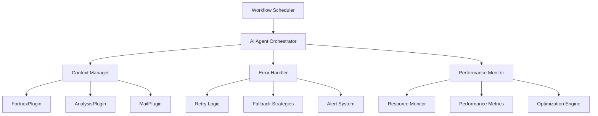

# AI Agent Orchestration Pattern for Scheduled Reporting

## Overview

This document describes the AI agent orchestration pattern used for automated financial reporting with the AnalysisPlugin. The pattern enables intelligent, adaptive report generation that can handle errors, optimize performance, and provide meaningful feedback to stakeholders.

## Architecture Pattern

### Core Components



### Orchestration Flow

1. **Trigger Phase**: Workflow scheduler activates AI agent
2. **Context Phase**: AI agent gathers context and validates prerequisites
3. **Execution Phase**: AI agent orchestrates plugin calls with error handling
4. **Delivery Phase**: AI agent manages report distribution and notifications
5. **Monitoring Phase**: AI agent logs metrics and handles post-execution tasks

## AI Agent Implementation Pattern

### Core Orchestrator Class

```python
class FinancialReportOrchestrator:
    def __init__(self, kernel, logger, config):
        self.kernel = kernel
        self.logger = logger
        self.config = config
        self.context_manager = ContextManager()
        self.error_handler = ErrorHandler()
        self.performance_monitor = PerformanceMonitor()
        
    async def orchestrate_scheduled_report(self, schedule_config):
        """Main orchestration method for scheduled reports"""
        execution_context = None
        
        try:
            # Phase 1: Initialize execution context
            execution_context = await self._initialize_context(schedule_config)
            
            # Phase 2: Validate prerequisites
            await self._validate_prerequisites(execution_context)
            
            # Phase 3: Execute report generation
            report_result = await self._execute_report_generation(execution_context)
            
            # Phase 4: Handle result and deliver
            await self._handle_result_and_deliver(execution_context, report_result)
            
            # Phase 5: Post-execution monitoring
            await self._post_execution_monitoring(execution_context, report_result)
            
        except Exception as ex:
            await self._handle_orchestration_failure(execution_context, ex)
            
    async def _initialize_context(self, schedule_config):
        """Initialize execution context with all necessary information"""
        context = ExecutionContext(
            schedule_id=schedule_config.schedule_id,
            report_type=schedule_config.report_type,
            start_time=datetime.utcnow(),
            config=schedule_config
        )
        
        # Load historical performance data
        context.historical_performance = await self._load_performance_history(
            schedule_config.schedule_id
        )
        
        # Determine optimal resource allocation
        context.resource_allocation = await self._calculate_resource_needs(
            schedule_config, context.historical_performance
        )
        
        self.logger.info(f"Initialized context for schedule {schedule_config.schedule_id}")
        return context
```

### Error Handling Strategy

```python
class ErrorHandler:
    def __init__(self):
        self.retry_strategies = {
            "REQUEST_VALIDATION_FAILED": self._handle_validation_error,
            "NO_TRANSACTIONS_FOUND": self._handle_no_data_error,
            "COMPONENT_CONFIGURATION_INVALID": self._handle_config_error,
            "TIMEOUT_EXCEEDED": self._handle_timeout_error,
            "INSUFFICIENT_MEMORY": self._handle_memory_error,
            "UNEXPECTED_ERROR": self._handle_unexpected_error
        }
        
    async def handle_error(self, error_result, execution_context):
        """Handle errors based on structured error codes"""
        error_code = error_result.error_code
        
        if error_code in self.retry_strategies:
            return await self.retry_strategies[error_code](error_result, execution_context)
        else:
            return await self._handle_unknown_error(error_result, execution_context)
            
    async def _handle_validation_error(self, error_result, context):
        """Handle request validation failures with parameter adjustment"""
        suggestions = error_result.get_suggested_actions()
        
        # Attempt to fix common validation issues
        if "date range" in error_result.error_message.lower():
            # Adjust date range to valid period
            context.config.start_date = self._get_safe_start_date(context.config)
            context.config.end_date = self._get_safe_end_date(context.config)
            return RetryDecision.RETRY_WITH_ADJUSTED_PARAMS
            
        elif "format" in error_result.error_message.lower():
            # Fall back to default format
            context.config.format = "Excel"
            return RetryDecision.RETRY_WITH_ADJUSTED_PARAMS
            
        return RetryDecision.FAIL_WITH_NOTIFICATION
        
    async def _handle_no_data_error(self, error_result, context):
        """Handle cases where no transactions are found"""
        # Check if this is expected (e.g., weekend, holiday)
        if self._is_expected_no_data_period(context.config.start_date, context.config.end_date):
            # Send informational email instead of error
            await self._send_no_data_notification(context)
            return RetryDecision.COMPLETE_WITH_INFO
        else:
            # Expand date range and retry
            context.config.start_date = context.config.start_date.add_days(-7)
            return RetryDecision.RETRY_WITH_EXPANDED_RANGE
```

### Performance Optimization

```python
class PerformanceMonitor:
    def __init__(self):
        self.metrics_collector = MetricsCollector()
        self.optimization_engine = OptimizationEngine()
        
    async def optimize_execution(self, execution_context):
        """Optimize execution based on historical performance and current conditions"""
        
        # Analyze historical performance
        historical_data = execution_context.historical_performance
        
        # Predict resource requirements
        predicted_memory = self._predict_memory_usage(execution_context.config, historical_data)
        predicted_time = self._predict_execution_time(execution_context.config, historical_data)
        
        # Adjust parameters for optimal performance
        optimizations = {
            "memory_limit_mb": min(predicted_memory * 1.2, 2048),  # 20% buffer, max 2GB
            "timeout_seconds": min(predicted_time * 1.5, 1800),   # 50% buffer, max 30min
            "batch_size": self._calculate_optimal_batch_size(predicted_memory),
            "use_streaming": predicted_memory > 512  # Use streaming for large datasets
        }
        
        execution_context.optimizations = optimizations
        
        self.logger.info(f"Applied optimizations: {optimizations}")
        return optimizations
        
    async def monitor_execution(self, execution_context, report_result):
        """Monitor execution and collect performance metrics"""
        
        metrics = {
            "execution_time_ms": report_result.generation_time_ms,
            "transaction_count": report_result.transaction_count,
            "component_count": report_result.component_count,
            "memory_used_mb": self._get_peak_memory_usage(),
            "success": report_result.is_successful,
            "error_code": report_result.error_code,
            "schedule_id": execution_context.schedule_id,
            "timestamp": datetime.utcnow()
        }
        
        # Store metrics for future optimization
        await self.metrics_collector.store_metrics(metrics)
        
        # Update performance model
        await self.optimization_engine.update_model(metrics)
        
        return metrics
```

## Context Management

### Execution Context

```python
class ExecutionContext:
    def __init__(self, schedule_id, report_type, start_time, config):
        self.schedule_id = schedule_id
        self.report_type = report_type
        self.start_time = start_time
        self.config = config
        
        # Performance data
        self.historical_performance = None
        self.resource_allocation = None
        self.optimizations = None
        
        # Execution tracking
        self.retry_count = 0
        self.max_retries = 3
        self.execution_steps = []
        
        # Results
        self.report_result = None
        self.delivery_result = None
        self.final_metrics = None
        
    def add_execution_step(self, step_name, status, details=None):
        """Track execution steps for debugging and monitoring"""
        step = {
            "step": step_name,
            "status": status,
            "timestamp": datetime.utcnow(),
            "details": details
        }
        self.execution_steps.append(step)
        
    def can_retry(self):
        """Check if retry is allowed based on current state"""
        return self.retry_count < self.max_retries
        
    def increment_retry(self):
        """Increment retry counter"""
        self.retry_count += 1
```

## Integration with Semantic Kernel

### Plugin Registration

```python
# Register AnalysisPlugin functions
kernel.add_plugin(
    AnalysisPlugin(),
    plugin_name="AnalysisPlugin"
)

# Register FortnoxPlugin functions  
kernel.add_plugin(
    FortnoxPlugin(),
    plugin_name="FortnoxPlugin"
)

# Register MailPlugin functions
kernel.add_plugin(
    MailPlugin(),
    plugin_name="MailPlugin"
)
```

### Function Invocation Pattern

```python
async def _execute_report_generation(self, execution_context):
    """Execute report generation using Semantic Kernel functions"""
    
    try:
        # Step 1: Retrieve SIE4 data
        execution_context.add_execution_step("retrieve_sie4_data", "started")
        
        get_sie_function = self.kernel.plugins["FortnoxPlugin"]["GetSIEAsync"]
        sie4_result = await self.kernel.invoke_async(
            get_sie_function,
            KernelArguments(financialYear=execution_context.config.financial_year)
        )
        
        sie4_data = sie4_result.value
        execution_context.add_execution_step("retrieve_sie4_data", "completed", 
                                           {"data_length": len(sie4_data)})
        
        # Step 2: Generate report
        execution_context.add_execution_step("generate_report", "started")
        
        generate_function = self.kernel.plugins["AnalysisPlugin"]["GenerateFinancialReportAsync"]
        report_result = await self.kernel.invoke_async(
            generate_function,
            KernelArguments(
                sie4Data=sie4_data,
                reportType=execution_context.config.report_type,
                format=execution_context.config.format,
                startDate=execution_context.config.start_date.isoformat(),
                endDate=execution_context.config.end_date.isoformat(),
                language=execution_context.config.language
            )
        )
        
        execution_context.add_execution_step("generate_report", "completed")
        return report_result.value
        
    except Exception as ex:
        execution_context.add_execution_step("generate_report", "failed", {"error": str(ex)})
        raise

## Adaptive Behavior Patterns

### Dynamic Parameter Adjustment

The AI agent adapts its behavior based on:

1. **Historical Performance**: Adjusts timeouts and memory limits based on past executions
2. **Data Volume**: Switches to streaming mode for large datasets
3. **Error Patterns**: Learns from previous failures to prevent recurring issues
4. **Resource Availability**: Scales processing based on system resources

### Intelligent Retry Logic

```python
class RetryStrategy:
    def __init__(self):
        self.backoff_multiplier = 1.5
        self.max_backoff_seconds = 300  # 5 minutes

    async def should_retry(self, error_result, execution_context):
        """Determine if and how to retry based on error type and context"""

        if not execution_context.can_retry():
            return False, None

        retry_strategies = {
            "REQUEST_VALIDATION_FAILED": {
                "should_retry": True,
                "delay_seconds": 5,
                "modifications": ["adjust_parameters"]
            },
            "NO_TRANSACTIONS_FOUND": {
                "should_retry": True,
                "delay_seconds": 10,
                "modifications": ["expand_date_range"]
            },
            "TIMEOUT_EXCEEDED": {
                "should_retry": True,
                "delay_seconds": 60,
                "modifications": ["increase_timeout", "enable_streaming"]
            },
            "INSUFFICIENT_MEMORY": {
                "should_retry": True,
                "delay_seconds": 30,
                "modifications": ["reduce_batch_size", "enable_streaming"]
            }
        }

        strategy = retry_strategies.get(error_result.error_code)
        if strategy and strategy["should_retry"]:
            delay = min(
                strategy["delay_seconds"] * (self.backoff_multiplier ** execution_context.retry_count),
                self.max_backoff_seconds
            )
            return True, delay

        return False, None
```

### Contextual Decision Making

```python
class ContextualDecisionEngine:
    def __init__(self):
        self.decision_rules = self._load_decision_rules()

    async def make_delivery_decision(self, execution_context, report_result):
        """Make intelligent decisions about report delivery"""

        decisions = {
            "should_deliver": True,
            "delivery_method": "email",
            "priority": "normal",
            "additional_recipients": [],
            "custom_message": None
        }

        # Analyze report content and context
        if report_result.transaction_count == 0:
            decisions["custom_message"] = "No transactions found for the specified period."
            decisions["priority"] = "low"

        elif report_result.generation_time_ms > 30000:  # > 30 seconds
            decisions["additional_recipients"].append("it-support@company.com")
            decisions["custom_message"] = "Report generation took longer than expected."

        # Check for anomalies in financial data
        anomalies = await self._detect_financial_anomalies(report_result)
        if anomalies:
            decisions["priority"] = "high"
            decisions["additional_recipients"].append("cfo@company.com")
            decisions["custom_message"] = f"Anomalies detected: {', '.join(anomalies)}"

        return decisions

    async def _detect_financial_anomalies(self, report_result):
        """Detect potential anomalies in financial data"""
        anomalies = []

        # Example anomaly detection logic
        if hasattr(report_result, 'financial_metrics'):
            metrics = report_result.financial_metrics

            # Check for unusual profit margins
            if metrics.get('profit_margin', 0) < -0.5:  # -50%
                anomalies.append("Unusually low profit margin")

            # Check for large expense spikes
            if metrics.get('expense_variance', 0) > 2.0:  # 200% increase
                anomalies.append("Significant expense increase")

        return anomalies
```

## Monitoring and Observability

### Comprehensive Logging

```python
class OrchestrationLogger:
    def __init__(self, logger):
        self.logger = logger

    def log_orchestration_start(self, execution_context):
        """Log the start of orchestration with context"""
        self.logger.info(
            "Starting report orchestration",
            extra={
                "schedule_id": execution_context.schedule_id,
                "report_type": execution_context.report_type,
                "config": execution_context.config.__dict__,
                "correlation_id": execution_context.correlation_id
            }
        )

    def log_step_completion(self, execution_context, step_name, metrics=None):
        """Log completion of orchestration step"""
        self.logger.info(
            f"Completed orchestration step: {step_name}",
            extra={
                "schedule_id": execution_context.schedule_id,
                "step": step_name,
                "metrics": metrics or {},
                "correlation_id": execution_context.correlation_id
            }
        )

    def log_error_handling(self, execution_context, error_result, retry_decision):
        """Log error handling decisions"""
        self.logger.warning(
            "Handling orchestration error",
            extra={
                "schedule_id": execution_context.schedule_id,
                "error_code": error_result.error_code,
                "error_message": error_result.error_message,
                "retry_decision": retry_decision,
                "retry_count": execution_context.retry_count,
                "correlation_id": execution_context.correlation_id
            }
        )
```

### Performance Metrics

Key metrics tracked by the AI agent:

- **Execution Time**: Total time from trigger to completion
- **Plugin Response Times**: Individual plugin call durations
- **Memory Usage**: Peak memory consumption during processing
- **Success Rate**: Percentage of successful executions
- **Error Distribution**: Frequency of different error types
- **Retry Effectiveness**: Success rate after retries
- **Data Volume**: Transaction counts and file sizes processed

### Health Checks

```python
class OrchestrationHealthCheck:
    async def check_system_health(self):
        """Perform comprehensive health check before orchestration"""

        health_status = {
            "overall": "healthy",
            "components": {},
            "warnings": [],
            "errors": []
        }

        # Check plugin availability
        for plugin_name in ["FortnoxPlugin", "AnalysisPlugin", "MailPlugin"]:
            try:
                await self._check_plugin_health(plugin_name)
                health_status["components"][plugin_name] = "healthy"
            except Exception as ex:
                health_status["components"][plugin_name] = "unhealthy"
                health_status["errors"].append(f"{plugin_name}: {str(ex)}")

        # Check resource availability
        memory_usage = self._get_memory_usage_percentage()
        if memory_usage > 80:
            health_status["warnings"].append(f"High memory usage: {memory_usage}%")

        # Check external dependencies
        if not await self._check_riksbank_api():
            health_status["warnings"].append("Riksbank API unavailable - exchange rates may be stale")

        # Determine overall health
        if health_status["errors"]:
            health_status["overall"] = "unhealthy"
        elif health_status["warnings"]:
            health_status["overall"] = "degraded"

        return health_status
```

## Best Practices

### 1. Graceful Degradation
- Always provide fallback options for failed operations
- Use cached data when real-time data is unavailable
- Simplify reports when full processing fails

### 2. Resource Management
- Monitor memory usage and implement streaming for large datasets
- Set appropriate timeouts based on historical performance
- Clean up resources after each execution

### 3. Error Communication
- Provide clear, actionable error messages to stakeholders
- Include suggested remediation steps in error notifications
- Maintain audit trails for troubleshooting

### 4. Continuous Improvement
- Learn from execution patterns to optimize future runs
- Update decision rules based on operational experience
- Regularly review and tune performance parameters

### 5. Security and Compliance
- Validate all inputs and sanitize outputs
- Maintain access logs for audit purposes
- Encrypt sensitive data in transit and at rest
- Follow principle of least privilege for plugin access
```
