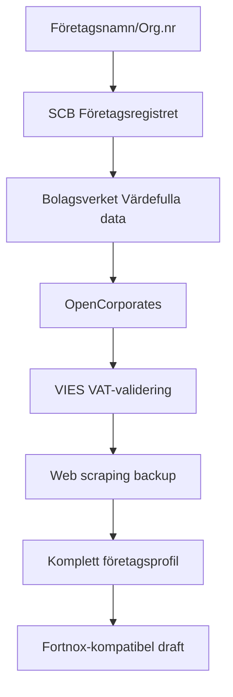

# CompanyCheckupPlugin

En kraftfull plugin för att slå upp svenska företag och förbereda data för Fortnox-integration. Använder officiella svenska myndighets-API:er och internationella källor för att hitta företagsinformation inklusive adresser.

## 🏛️ Datakällor (prioritetsordning)

### **Officiella svenska myndigheter (gratis):**
1. **SCB Företagsregistret** - Helt avgiftsfritt, aktuella företagsdata med adresser
2. **Bolagsverkets "Värdefulla datamängder"** - Gratis efter enkel registrering

### **Internationella källor:**
3. **OpenCorporates** - 200 gratis API-anrop per månad
4. **VIES** - EU:s officiella VAT-validering

### **Backup-källor (web scraping):**
5. **UC.se, Hitta.se, Ratsit.se, Eniro.se** - För ytterligare kontaktinformation

## ⚙️ Konfiguration

Lägg till i `appsettings.json`:

```json
{
  "CompanyCheckup": {
    "BolagsverketVardefullaData": {
      "ApiKey": "DIN_API_NYCKEL",
      "ApiUrl": "https://data.bolagsverket.se/api/bolagsverket/foretagsformer",
      "Description": "Bolagsverkets 'Värdefulla datamängder' API - gratis efter registrering"
    },
    "SCBForetagsregistret": {
      "ApiUrl": "https://api.scb.se/OV0104/v1/doris/sv/ssd/START/BE/BE0101/BE0101A",
      "Description": "SCB Företagsregistret - helt avgittsfritt, ingen nyckel krävs"
    },
    "OpenCorporates": {
      "ApiKey": "",
      "ApiUrl": "https://api.opencorporates.com/v0.4",
      "FreeCallsPerMonth": 200,
      "Description": "OpenCorporates - 200 gratis anrop per månad"
    }
  }
}
```

## 🚀 Grundläggande användning

```csharp
// Initiera plugin
var configuration = new ConfigurationBuilder()
    .AddJsonFile("appsettings.json")
    .Build();

var plugin = new CompanyCheckupPlugin.Plugin(configuration);

// Slå upp företag
var result = await plugin.LookupCompanyAsync("Example AB");
Console.WriteLine(result);
```

## 📊 Exempel på output

```json
{
  "Match": {
    "Confidence": 1.0,
    "Sources": ["Bolagsverket", "VIES", "SCB"]
  },
  "Profile": {
    "LegalName": "Example AB",
    "Registration": {
      "OrgNumber": "556714-4950",
      "VatNumber": "SE556714495001",
      "CountryCode": "SE",
      "Status": "Aktiv"
    },
    "Addresses": {
      "Registered": {
        "Line1": "Storgatan 123",
        "Zip": "11122",
        "City": "Stockholm",
        "CountryCode": "SE"
      }
    },
    "Contacts": {
      "Email": "noreply@example.com",
      "Phone": "+46 8 123 456"
    },
    "Metadata": {
      "Sources": ["Bolagsverket", "VIES", "SCB"],
      "RequestIdentifier": "SE556714495001/2025-08-29",
      "RequestTimestamp": "2025-08-29T20:55:37.353635Z"
    }
  },
  "Drafts": {
    "FortnoxSupplier": {
      "Name": "Example AB",
      "OrganisationNumber": "556714-4950",
      "VATNumber": "SE556714495001",
      "Address1": "Storgatan 123",
      "ZipCode": "11122",
      "City": "Stockholm",
      "CountryCode": "SE",
      "Email": "noreply@example.com",
      "Phone": "+46 8 123 456",
      "Type": "COMPANY",
      "Active": true,
      "Currency": "SEK",
      "Country": "Sverige",
      "Comments": "Automatiskt skapad från företagsuppslag. Status: Aktiv. Endast verifierad data används."
    }
  }
}
```

## Integration with FortnoxPlugin

The `drafts.fortnoxSupplier` object can be directly used with the FortnoxPlugin:

```csharp
// Parse the company lookup result
var companyResult = JsonSerializer.Deserialize<CompanyCheckupResult>(result);

// Create customer in Fortnox using the draft
var fortnoxPlugin = new Fortnox.Plugin(configuration);
var customerRequest = new CustomerRequest 
{
    Customer = new Customer
    {
        Name = companyResult.Drafts.FortnoxSupplier.Name,
        OrganisationNumber = companyResult.Drafts.FortnoxSupplier.OrganisationNumber,
        VATNumber = companyResult.Drafts.FortnoxSupplier.VATNumber,
        Address1 = companyResult.Drafts.FortnoxSupplier.Address1,
        ZipCode = companyResult.Drafts.FortnoxSupplier.ZipCode,
        City = companyResult.Drafts.FortnoxSupplier.City,
        CountryCode = companyResult.Drafts.FortnoxSupplier.CountryCode,
        // Add required fields that may be missing
        Active = true,
        Type = "COMPANY"
    }
};

var fortnoxResult = await fortnoxPlugin.CreateCustomerAsync(customerRequest);
```

## Supported Input Formats

The plugin accepts various input formats:

- Company names: `"Volvo"`, `"Example AB"`
- Organization numbers: `"556012-5790"`, `"5560125790"`
- VAT numbers: `"SE556012579001"`

## 🔍 Stödda sökformat

Plugin:en accepterar olika format:

- **Företagsnamn**: `"Volvo"`, `"Example AB"`, `"IKEA"`
- **Organisationsnummer**: `"556714-4950"`, `"5567144950"`
- **VAT-nummer**: `"SE556714495001"`

## 🎯 Funktioner

### **Automatisk dataförstärkning:**
- ✅ **Organisationsnummer** → **VAT-nummer** (SE556714495001)
- ✅ **VIES-validering** → Verifierar VAT-nummer i EU-registret
- ✅ **Adresssökning** → Från SCB, Bolagsverket, OpenCorporates
- ✅ **Kontaktinformation** → Telefon och e-post från flera källor

### **Intelligent fallback:**
- ✅ **Officiella källor först** → SCB, Bolagsverket
- ✅ **Internationella backup** → OpenCorporates, VIES
- ✅ **Web scraping backup** → UC.se, Hitta.se, Ratsit.se, Eniro.se
- ✅ **Ärlig rapportering** → "Adress saknas" om ingen data hittas

### **Fortnox-integration:**
- ✅ **Komplett draft** → Alla obligatoriska fält för Fortnox
- ✅ **Automatisk konvertering** → Från företagsdata till Fortnox-format
- ✅ **Validering** → Säkerställer att all nödvändig data finns

## 🔧 API-nycklar (valfritt)

### **Bolagsverkets "Värdefulla datamängder":**
1. Registrera dig på [Bolagsverket](https://data.bolagsverket.se)
2. Ansök om API-nyckel för "Värdefulla datamängder"
3. Lägg till nyckeln i `appsettings.json`

### **OpenCorporates (för fler anrop):**
1. Skapa konto på [OpenCorporates](https://opencorporates.com)
2. Uppgradera till betald plan för fler än 200 anrop/månad
3. Lägg till API-nyckeln i `appsettings.json`

## 🚨 Felhantering

Plugin:en returnerar felmeddelanden för misslyckade sökningar:

```json
"❌ Fel vid företagsuppslag: [felmeddelande]"
```

## 💬 Chat-integration

I WebChat kan användare fråga:

> **"Kolla upp företaget Example AB och skapa sedan dem som kund i Fortnox"**

AI-agenten kommer att:
1. Använda CompanyCheckupPlugin för att slå upp företaget
2. Extrahera `fortnoxSupplier`-objektet från resultatet
3. Använda FortnoxPlugin för att skapa kunden
4. Ge feedback till användaren

## 🔄 Dataflöde



## 📈 Prestanda

- **SCB/Bolagsverket**: Obegränsade anrop (gratis)
- **OpenCorporates**: 200 gratis anrop/månad
- **VIES**: Obegränsade anrop (EU-myndighet)
- **Web scraping**: Begränsad av rate limiting

## 🛡️ Säkerhet

- ✅ **Inga hårdkodade API-nycklar** i källkoden
- ✅ **Konfigurationsbaserad** autentisering
- ✅ **Miljövariabler** stöds för produktion
- ✅ **Graceful degradation** om API:er är nere